[README.md](https://github.com/user-attachments/files/34527868/README.md)
# Introdução

Este repositório documenta a atividade individual de testes caixa cinza em uma API de autenticação, realizada com Supabase (ambiente de autenticação), Postman Desktop (execução dos testes) e **GitHub** (documentação).

- **Aluno:** Lucas Gomes
- **Data de realização:** 07/11/2026
- **Endpoint testado:** `POST /auth/v1/token?grant_type=password`

Estrutura do repositório:

```
/README.md
/postman/    -> collection e environment exportados do Postman
/prints/     -> evidências (prints) de todas as etapas
/planilha/   -> planilha de registro dos testes
```

---

# Objetivo da Atividade

Compreender e aplicar testes de caixa cinza em APIs de autenticação, usando ferramentas de mercado para configurar, executar e validar testes funcionais. Na caixa cinza, o testador conhece parte da estrutura do sistema (endpoint, autenticação, headers, body JSON e respostas HTTP), mas não o código interno.

Nesta atividade foram feitos:

- configuração de um ambiente de autenticação no Supabase;
- criação de um usuário de teste;
- configuração do Postman (workspace, environment e variáveis);
- criação e execução de requisições HTTP;
- validação de status, respostas JSON, mensagens de erro e access token;
- registro dos testes em planilha e documentação técnica neste README.

---

# Configuração do Supabase

**Como o projeto foi criado:** criei uma conta no Supabase e, em seguida, um novo projeto chamado `venturagomeslucas's Project`, hospedado na região East US (North Virginia). Após o provisionamento, o painel apresentou o status *Healthy*.

**Tipo de autenticação:** autenticação por **e-mail e senha** (provider *Email* habilitado em *Authentication > Sign In / Providers*). A opção *Confirm email* está ligada, ou seja, um usuário só consegue logar após ter o e-mail confirmado.

**Como o usuário foi criado:** em *Authentication > Users*, usei *Add user > Create new user*, informei e-mail e senha e marquei *Auto Confirm User*, para que o usuário já estivesse confirmado e pudesse fazer login.

**Credenciais da API:** em *Project Settings > API Keys* obtive a **Project URL** e a **publishable key** (equivalente à antiga *anon key*), usadas no Postman. A chave `service_role`/secret não foi utilizada.

**Objetivo da configuração:** ter um serviço real de autenticação, com um usuário válido, para poder testar o login por meio de requisições HTTP.

### Evidências

**Projeto criado e painel do Supabase**

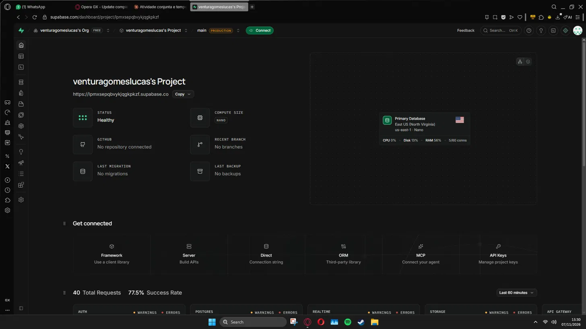

**Autenticação por e-mail habilitada**

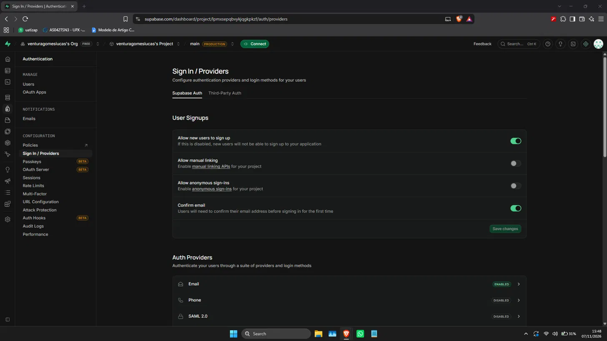

**Usuário criado**

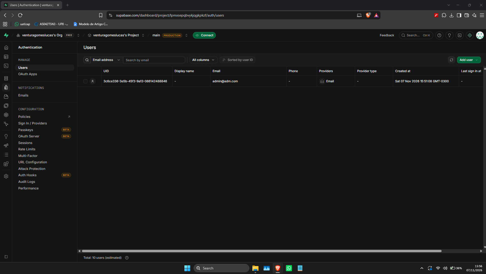

**Credenciais da API (URL e chave)**

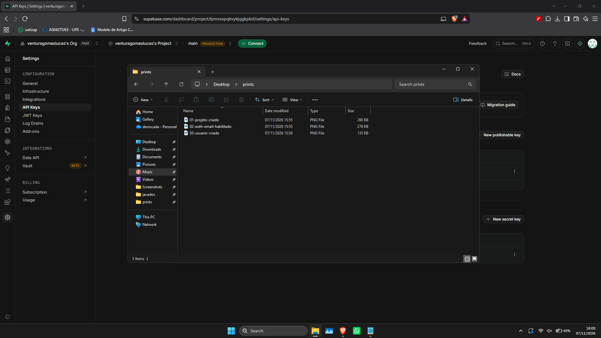

**Identificação do aluno no ambiente**

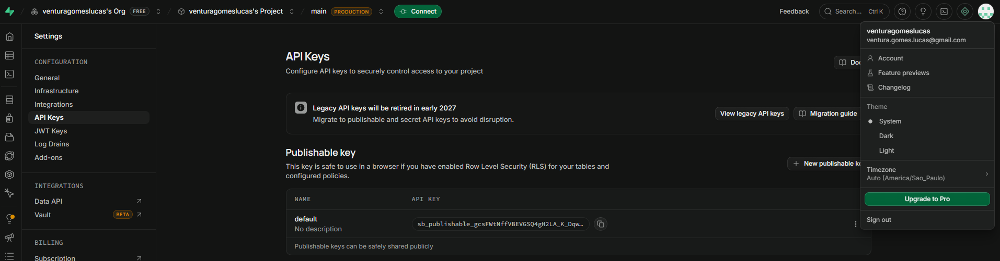

---

# Configuração do Postman

**Workspace:** instalei o Postman Desktop e criei um workspace em branco chamado `Teste Caixa Cinza - Supabase - Lucas`, para manter toda a atividade organizada.

**Environment:** criei o environment `Supabase Auth` e o selecionei como ativo no canto superior direito. Nele configurei as variáveis abaixo:

| Variável | Descrição |
|---|---|
| `base_url` | URL da API do Supabase (Project URL) |
| `api_key` | Chave pública (publishable key) do projeto |
| `email` | E-mail do usuário criado para os testes |
| `password` | Senha do usuário criado |

**Finalidade das variáveis:** evitam repetir dados sensíveis ou que mudam nas requisições. Em vez de digitar a URL, a chave e as credenciais em cada teste, as requisições usam `{{base_url}}`, `{{api_key}}`, `{{email}}` e `{{password}}`. Se algum valor mudar, basta alterar o environment.

**Como o Postman foi usado:** foi criada a collection `Testes Auth Supabase` com a requisição `Login - POST token`. Os cenários de teste foram executados alterando apenas o body da requisição e observando o status e a resposta.

### Evidências

**Workspace criado**

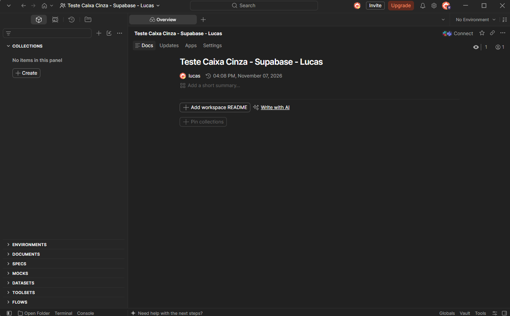

**Environment com as variáveis** (senha e parte da chave ocultadas)

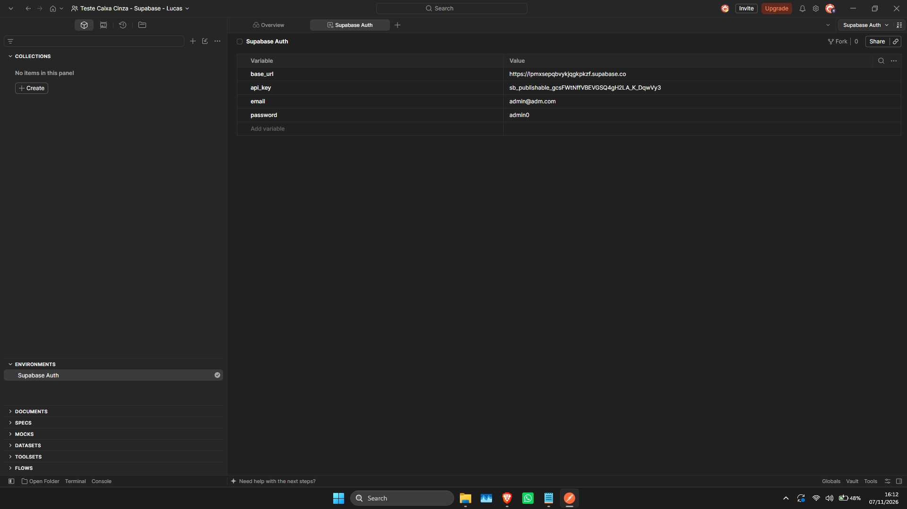

**Organização do Postman**


---

# Configuração das Requisições

| Item | Valor |
|---|---|
| **Método HTTP** | `POST` |
| **Endpoint** | `{{base_url}}/auth/v1/token?grant_type=password` |
| **Finalidade** | Autenticar um usuário por e-mail e senha e obter o access token |

### Headers utilizados

| Header | Valor |
|---|---|
| `apikey` | `XXXXX` (valor de `{{api_key}}`) |
| `Authorization` | `Bearer XXXXX` (valor de `{{api_key}}`) |
| `Content-Type` | `application/json` |

### Body JSON utilizado

```json
{
  "email": "usuario@email.com",
  "password": "123456"
}
```

> No Postman o body usa as variáveis do environment: `"email": "{{email}}"` e `"password": "{{password}}"`. Os valores acima são apenas ilustrativos.

**Finalidade da requisição:** enviar as credenciais ao serviço de autenticação do Supabase. Se forem válidas, a API retorna status 200 com o `access_token` da sessão; se não forem, retorna um erro com status e mensagem.

### Evidências

**Endpoint e método configurados**


**Headers**

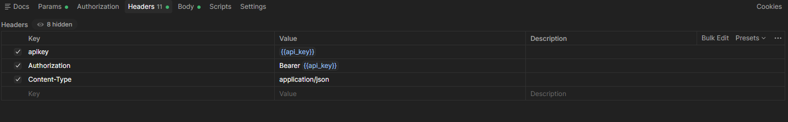

**Body JSON**

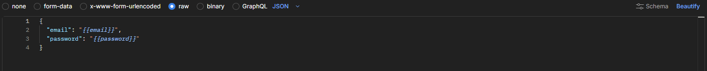

**Requisição criada na collection**

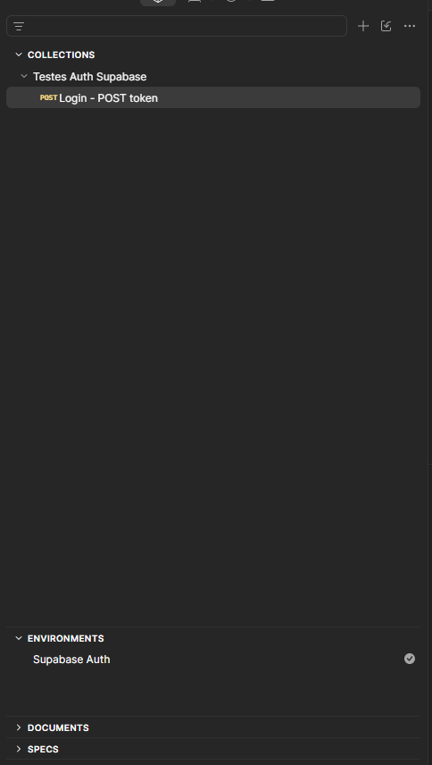

---

# Execução dos Testes

Foram executados os 5 cenários obrigatórios, sempre sobre o mesmo endpoint, alterando apenas o body.

| Cenário | Entrada Utilizada | Resultado Esperado | Resultado Obtido | Status |
|---|---|---|---|---|
| Login válido | E-mail e senha corretos do usuário criado | Status 200 + access token | Status 200 OK; `access_token` retornado, `token_type: bearer`, `expires_in: 3600` | OK |
| Senha incorreta | E-mail correto + senha `teste` | Erro de autenticação | Status 400; `error_code: invalid_credentials`; `msg: Invalid login credentials` | OK |
| Usuário inexistente | E-mail `naoexiste@teste.com` + senha `teste` | Acesso negado | Status 400; `error_code: invalid_credentials`; `msg: Invalid login credentials` | OK |
| Campos vazios | E-mail `""` + senha `""` | Erro de validação | Status 400; `error_code: validation_failed`; `msg: missing email or phone` | OK |
| Credenciais inválidas | E-mail `teste` (sem formato de e-mail) + senha `teste` | Mensagem de erro | Status 400; `error_code: invalid_credentials`; `msg: Invalid login credentials` | OK |

**Validações realizadas em cada teste:** status HTTP, corpo da resposta JSON, mensagem de erro, presença (ou ausência) do access token e comportamento geral da autenticação.

**Erros encontrados:** nenhuma falha em relação ao esperado. Observações relevantes:

- Senha incorreta e usuário inexistente retornam exatamente a mesma resposta (`invalid_credentials`).
- Campos vazios retornam um erro de natureza diferente (`validation_failed`), o que indica validação prévia da entrada.
- Um e-mail sem `@` não gerou erro de formato específico; a API respondeu apenas como credenciais inválidas.

### Evidências

**Login válido (status 200 e access token)**

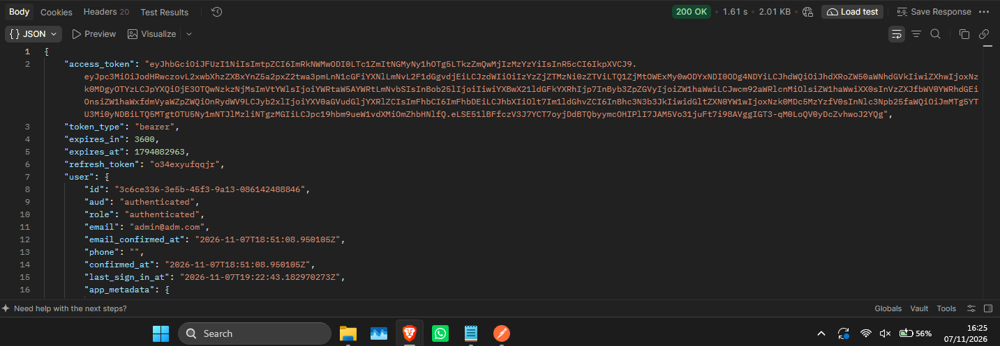

**Senha incorreta**

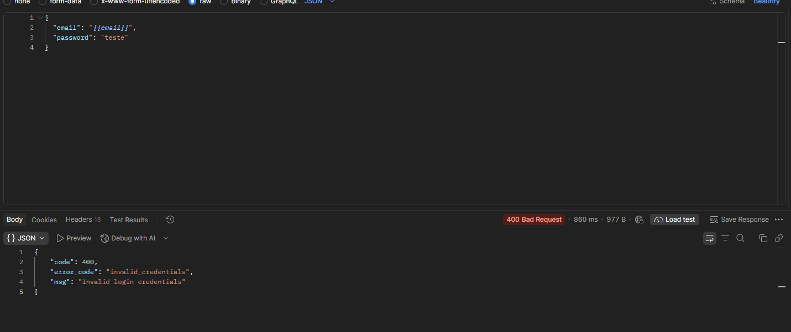

**Usuário inexistente**

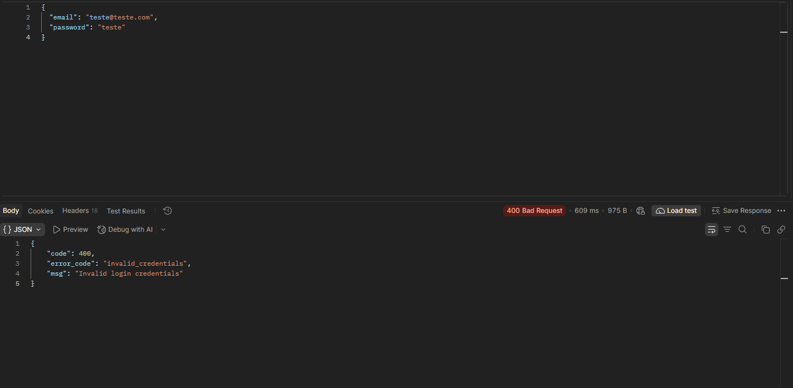

**Campos vazios**

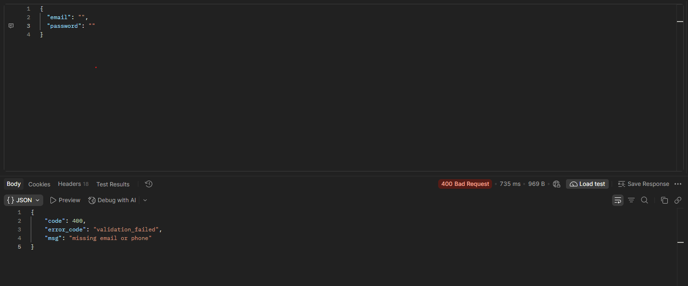

**Credenciais inválidas**

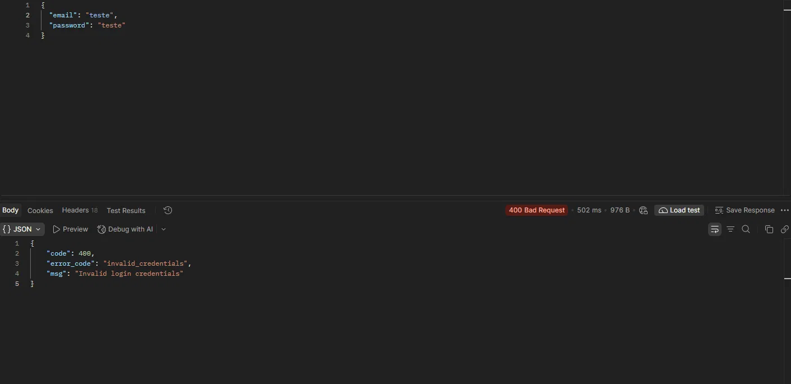

---

# Registro dos Testes

**Como os testes foram registrados:** todos os testes foram anotados em uma planilha com os campos *ID do teste, Cenário, Entrada, Resultado esperado, Resultado obtido, Status* e *Observações*. Os registros foram feitos logo após cada execução, com base no status e na resposta mostrados pelo Postman.

Arquivo: [`planilha/planilha-testes-caixa-cinza.xlsx`](planilha/planilha-testes-caixa-cinza.xlsx)

**Importância da documentação dos testes:** o registro permite repetir os testes, comparar resultados entre execuções, comprovar o que foi verificado e identificar falhas ou comportamentos inesperados. Sem documentação, o teste não pode ser auditado nem reaproveitado por outra pessoa.

**Falhas identificadas:** nenhum teste falhou em relação ao resultado esperado. Foram registrados apenas comportamentos dignos de nota, como a resposta idêntica para usuário inexistente e senha incorreta, e a ausência de erro específico de formato para e-mail inválido.

### Exemplos de registros

| ID | Cenário | Resultado obtido | Status |
|---|---|---|---|
| CT-01 | Login válido | 200 OK + access_token | Sucesso |
| CT-02 | Senha incorreta | 400, invalid_credentials | Sucesso |
| CT-04 | Campos vazios | 400, validation_failed | Sucesso |

### Evidência

**Planilha preenchida**

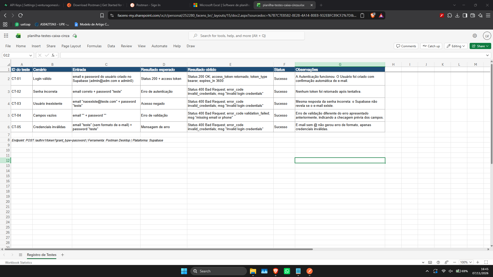

---

# Resultados Obtidos

| Total de cenários | Executados | Resultado conforme o esperado | Falhas |
|---|---|---|---|
| 5 | 5 | 5 | 0 |

- O **login válido** retornou status 200 com `access_token`, `refresh_token` e os dados do usuário, comprovando que a autenticação funciona.
- Os **quatro cenários inválidos** retornaram status 400 sem nenhum token, ou seja, o acesso foi negado em todos eles.
- As mensagens de erro são claras e padronizadas (`error_code` e `msg`), mas genéricas para falhas de credencial, o que é uma boa prática de segurança.

---

# Conclusão

**Os testes foram executados corretamente?** Sim. Os 5 cenários obrigatórios foram executados no Postman, com evidências reais produzidas por mim e registradas na planilha.

**A autenticação funcionou?** Sim. Com credenciais válidas a API retornou 200 e o access token; com entradas inválidas, negou o acesso com status 400 e mensagem de erro.

**Dificuldades encontradas:** a principal atenção foi com a opção *Confirm email* do Supabase, que exige e-mail confirmado antes do login; resolvi criando o usuário com *Auto Confirm User*. Também foi necessário restaurar o body original da requisição (com as variáveis) depois de cada cenário de erro, para não exportar a collection com dados de teste.

**Falhas identificadas:** não houve falhas em relação ao esperado. Como pontos de atenção, a API não distingue usuário inexistente de senha incorreta, e um e-mail sem formato válido não gerou erro de validação específico.

**Melhorias que poderiam ser implementadas:**

- validar o formato do e-mail e retornar uma mensagem específica para isso;
- adicionar testes automatizados no Postman (aba *Tests*) para checar status e campos da resposta;
- incluir cenários extras, como bloqueio após muitas tentativas (rate limit), senha muito curta e uso de token expirado;
- testar o uso do `access_token` em um endpoint protegido.

**Importância dos testes caixa cinza em APIs:** como o testador conhece endpoint, headers, body e respostas esperadas, é possível desenhar cenários mais direcionados do que em um teste totalmente caixa preta, sem depender do código interno. Isso permite validar contratos da API, tratamento de erros e comportamento de segurança, como a resposta genérica para credenciais inválidas, que evita revelar se um usuário existe.
